# Oracle 제품 설치 파일 다운로드 가이드

이 문서는 `Oracle GoldenGate 실전 데이터 플랫폼` Lab Kit에서 사용하는 대표
Oracle 제품 3종을 Oracle Software Delivery Cloud에서 직접 내려받는 전체
절차를 설명한다.

Oracle 제품 설치 파일과 라이선스가 적용되는 바이너리는 이 GitHub
저장소와 Lab Kit Release에 포함하지 않는다. 독자는 본인의 Oracle 계정으로
[Oracle Software Delivery Cloud](https://edelivery.oracle.com/)에 로그인하고,
현재 표시되는 라이선스 조건을 확인한 뒤 직접 내려받아야 한다.

화면의 제품명, release, 파일 크기와 part number는 Oracle의 제품 업데이트에
따라 달라질 수 있다. 이 문서의 화면은 2026년 10월 29일 검증 기준이며,
실제 다운로드 시에는 eDelivery에 표시되는 최신 정보와 `View Digest Details`를
우선한다.

## 다운로드할 대표 제품 3종

| 제품 | eDelivery 파일명 | 배치 위치 | 확인 기준 |
|---|---|---|---|
| Oracle AI Database 26ai EE, Linux x86-64 | `V1054592-01.zip` | `/home/oracle/oracle/pkg` | 2.3G, SHA-256 `2a5d2583df076209e624dff750829f9a562473c27c8f926d546cf9ad2a1a2efd` |
| Oracle GoldenGate for Oracle, Linux x86-64 | `V1054774-01.zip` | `/home/oracle/oracle/pkg` | 497M, SHA-256 `cd9220e74c7e3afe73bd00c40778faf8bee6cb0fb18140eee0e0ad9d4d140f96` |
| GoldenGate for Distributed Applications and Analytics, Linux x86-64 | `V1054834-01.zip` | `/home/oracle/oracle/pkg` | eDelivery 표시 520.7 MB, SHA-256 `8971fdfeb734a30df09b486f3c49a99ff4335a0daced21a8f70783d783413c45` |

## 공통 준비와 주의 사항

1. eDelivery에서 제품을 검색하려면 Oracle Account 로그인이 필요하다. 계정이
   없다면 sign-in 화면에서 `Create Account`를 선택해 생성한다.
2. 같은 브라우저 session에서는 이전에 선택한 제품이 Download Queue에 남을
   수 있다. 다음 제품을 받을 때 이미 다운로드한 제품의 상위 checkbox를
   해제하지 않으면 WGET script에 여러 제품이 함께 포함될 수 있다.
3. WGET script가 요청하는 access token은 eDelivery의 `WGET Options`에서
   `Generate Token`을 눌러 생성한다. 검증 환경에서는 약 1시간 동안
   유효했지만 실제 만료 시간은 Oracle 정책에 따라 달라질 수 있다.
4. Token은 터미널에 한 번만 붙여넣고 Enter를 누른다. 입력 문자가 보이지
   않더라도 다시 붙여넣지 않는다. Token, 임시 URL, Oracle 계정 정보는
   캡처하거나 GitHub에 올리지 않는다.
5. 제품 하나를 받을 때마다 바로 Docker image를 build하지 않는다. 필요한
   제품 media를 먼저 모두 다운로드하고 checksum을 검증한 뒤 image를
   일괄 build한다.

## 1. Oracle AI Database 26ai EE

### 1.1 제품 검색

eDelivery 검색창에 `Oracle AI Database`를 입력한다. 검색 결과의
`Oracle AI Database 23.26.1.0.0`은 Oracle AI Database 26ai 계열의
software version이다. 첫 번째 DLP 항목을 선택한다.

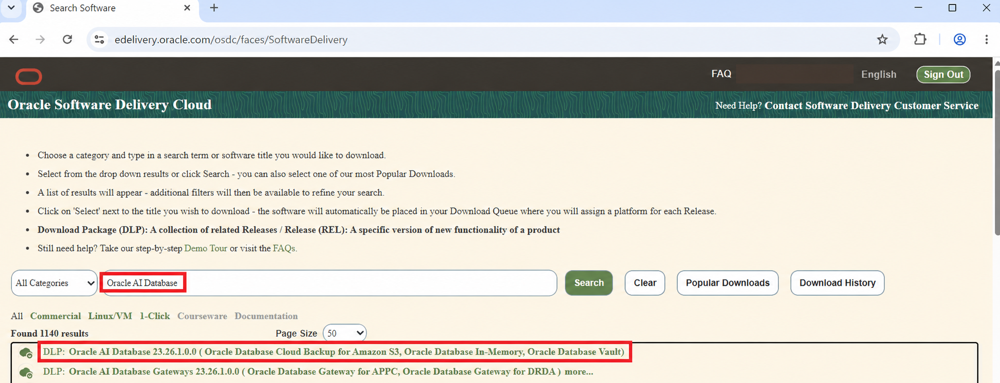

화면 오른쪽 위의 `View Items`에 선택 수가 표시되면 `Continue`를 클릭한다.

### 1.2 Platform과 파일 선택

Download Queue에서 `Oracle AI Database 23.26.1.0.0`을 선택하고
`Platforms / Languages`를 `Linux x86-64`로 지정한다. Database server
image를 만드는 데 별도의 Database Client package는 필요하지 않다.

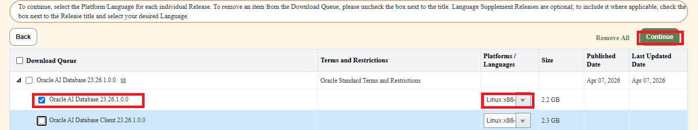

라이선스 내용을 확인한 뒤 `I reviewed and accept the Oracle License
Agreement`를 선택하고 `Continue`를 클릭한다.

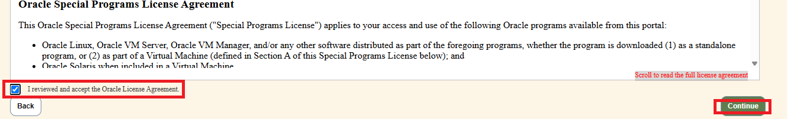

### 1.3 WGET script와 token 준비

파일 목록에서 `WGET Options`를 클릭한다. 팝업에서 먼저
`Download wget.sh`를 눌러 WGET script를 Windows Downloads 폴더에 저장한다.

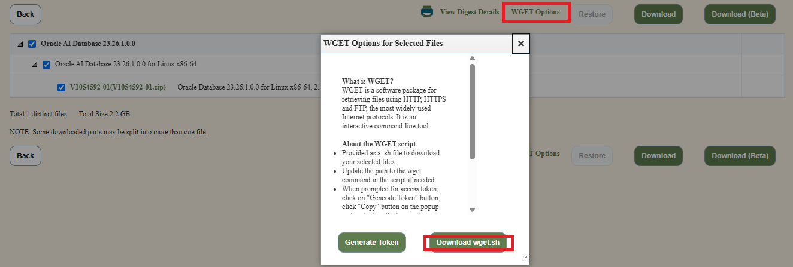

WSL에서 script를 제품별 이름으로 옮기고 실행 권한을 설정한다.

```text
[root@DESKTOP-4F78VMG ~]# cd /mnt/c/Users/<WindowsUser>/Downloads/
[root@DESKTOP-4F78VMG Downloads]# ls -ltr wget.sh
-rwxrwxrwx 1 root root 2379 Oct 29 09:05 wget.sh
[root@DESKTOP-4F78VMG Downloads]# mv wget.sh /home/oracle/oracle/pkg/wget_oracle_db_26ai.sh
[root@DESKTOP-4F78VMG Downloads]# cd /home/oracle/oracle/pkg
[root@DESKTOP-4F78VMG pkg]# chmod 700 wget_oracle_db_26ai.sh
[root@DESKTOP-4F78VMG pkg]# ls -l wget_oracle_db_26ai.sh
-rwx------ 1 root root 2379 Oct 29 09:05 wget_oracle_db_26ai.sh
```

Script를 실행하면 access token 입력을 기다린다.

```text
[root@DESKTOP-4F78VMG pkg]# sh wget_oracle_db_26ai.sh
Please paste your access token and press Enter:
```

브라우저의 `WGET Options`로 돌아가 `Generate Token`을 클릭한다.

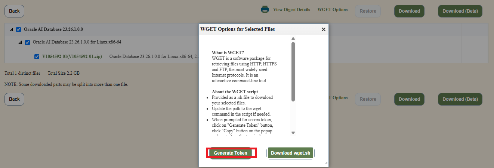

새 창에서 `Copy`를 클릭한 뒤 token을 터미널에 한 번 붙여넣고 Enter를 누른다.
다음 그림은 실제 token을 마스킹한 편집본이다.

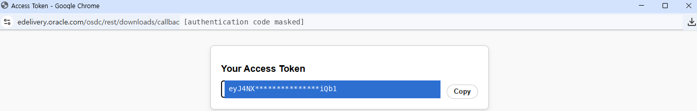

정상적으로 전달되면 background download가 시작된다. 출력이 잠시 없어도
`Download initiated (background)`가 표시됐다면 script를 다시 실행하지 않고
`Download completed`와 `Script Finished`가 나타날 때까지 기다린다.

```text
[ACCESS TOKEN MASKED]
[INFO] [2026-10-29 09:52:27] ==== Script Started ====
[INFO] [2026-10-29 09:52:27] Download initiated (background) for: V1054592-01.zip
[INFO] [2026-10-29 09:52:27] All download(s) initiated in background.
Please check logfile for more details: ./wgetlog-10-29-26-09:52.log
[INFO] [2026-10-29 09:53:22] Download completed: V1054592-01.zip (saved to: ./V1054592-01.zip)
[INFO] [2026-10-29 09:53:22] ==== Script Finished ====
[root@DESKTOP-4F78VMG pkg]#
```

### 1.4 파일 검증

```text
[root@DESKTOP-4F78VMG pkg]# ls -lh V1054592-01.zip
-rw-r--r-- 1 root root 2.3G Jan 23  2026 V1054592-01.zip
[root@DESKTOP-4F78VMG pkg]# sha256sum V1054592-01.zip
2a5d2583df076209e624dff750829f9a562473c27c8f926d546cf9ad2a1a2efd  V1054592-01.zip
[root@DESKTOP-4F78VMG pkg]#
```

## 2. Oracle GoldenGate for Oracle

### 2.1 제품 검색

eDelivery 검색창에 `Oracle GoldenGate`를 입력하고 `Search`를 클릭한다.
검색 결과에서 `DLP: Oracle GoldenGate 23.4`를 선택한다.

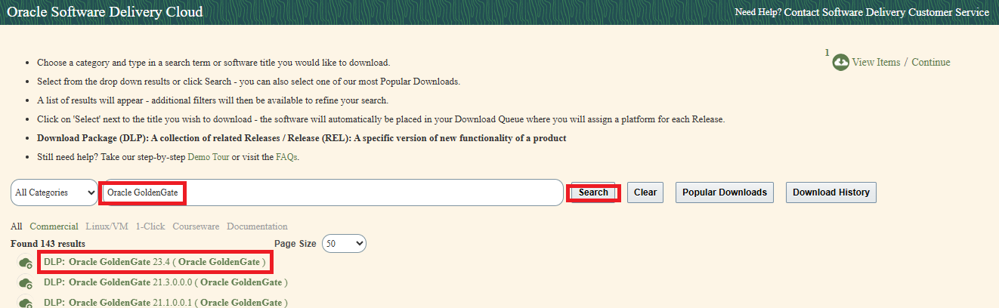

`View Items`에 선택 수가 표시되면 `Continue`를 클릭한다. 앞에서 선택한
Database 항목이 남아 있으면 선택 수가 2로 보일 수 있다.

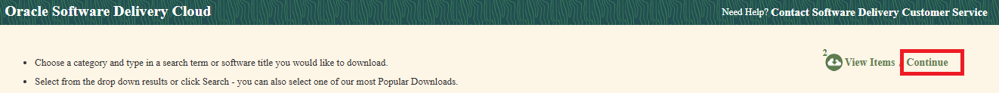

### 2.2 기존 항목 해제와 installer 선택

Download Queue에서 이미 받은 Database의 상위 checkbox를 해제하고
`Oracle GoldenGate 23.4.0.0.0`만 선택한다. Platform은 `Linux x86-64`로
지정한 뒤 `Continue`를 클릭한다.

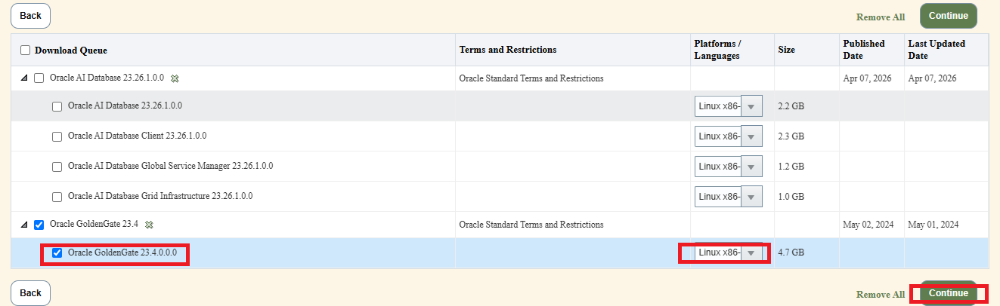

라이선스 내용을 확인하고 동의한 뒤 `Continue`를 클릭한다.

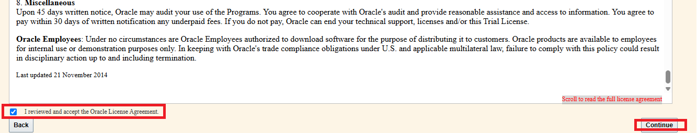

File list에서는 다음 Oracle Database용 installer만 선택한다.

```text
V1054774-01.zip
Oracle GoldenGate 23.26.1.0.0 on Linux x86-64 for Oracle
Size: 496.0 MB
```

DB2 for LUW용 `V1054817-01.zip` 등 다른 Database installer는 선택하지 않는다.
파일을 확인한 뒤 `WGET Options`를 열고 `Download wget.sh`를 클릭한다.

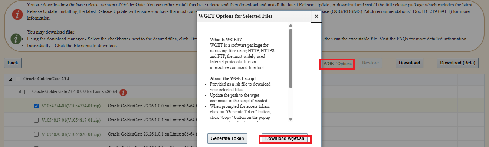

### 2.3 WGET script 실행

```text
[root@DESKTOP-4F78VMG pkg]# cd /mnt/c/Users/<WindowsUser>/Downloads/
[root@DESKTOP-4F78VMG Downloads]# ls -ltr wget.sh
-rwxrwxrwx 1 root root 2379 Oct 29 12:47 wget.sh
[root@DESKTOP-4F78VMG Downloads]# mv wget.sh /home/oracle/oracle/pkg/wget_oracle_goldengate_26ai.sh
[root@DESKTOP-4F78VMG Downloads]# cd /home/oracle/oracle/pkg
[root@DESKTOP-4F78VMG pkg]# chmod 700 wget_oracle_goldengate_26ai.sh
[root@DESKTOP-4F78VMG pkg]# ls -ltr wget_oracle_goldengate_26ai.sh
-rwx------ 1 root root 2379 Oct 29 12:47 wget_oracle_goldengate_26ai.sh
[root@DESKTOP-4F78VMG pkg]#
```

```text
[root@DESKTOP-4F78VMG pkg]# sh wget_oracle_goldengate_26ai.sh
Please paste your access token and press Enter:
```

`Generate Token`을 눌러 GoldenGate 다운로드용 새 token을 만든다.

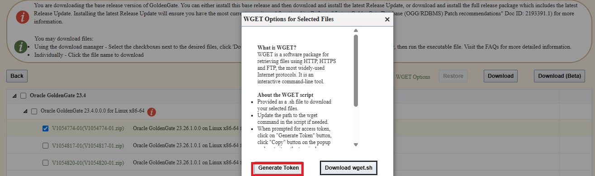

`Copy`를 클릭하고 터미널에 한 번만 붙여넣는다. 그림의 token과 주소창 인증
정보는 모두 마스킹되어 있다.

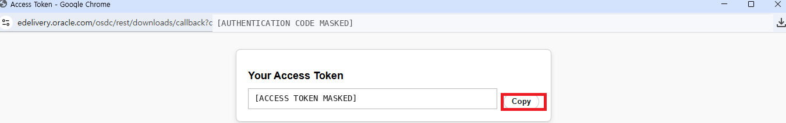

```text
[ACCESS TOKEN MASKED]
[INFO] [2026-10-29 12:53:51] ==== Script Started ====
[INFO] [2026-10-29 12:53:51] Download initiated (background) for: V1054774-01.zip
[INFO] [2026-10-29 12:53:51] All download(s) initiated in background.
Please check logfile for more details: ./wgetlog-10-29-26-12:51.log
[INFO] [2026-10-29 12:54:04] Download completed: V1054774-01.zip (saved to: ./V1054774-01.zip)
[INFO] [2026-10-29 12:54:04] ==== Script Finished ====
[root@DESKTOP-4F78VMG pkg]#
```

### 2.4 파일 검증

```text
[root@DESKTOP-4F78VMG pkg]# ls -lh V1054774-01.zip
-rw-r--r-- 1 root root 497M Jan 29  2026 V1054774-01.zip
[root@DESKTOP-4F78VMG pkg]# sha256sum V1054774-01.zip
cd9220e74c7e3afe73bd00c40778faf8bee6cb0fb18140eee0e0ad9d4d140f96  V1054774-01.zip
[root@DESKTOP-4F78VMG pkg]#
```

## 3. GoldenGate for Distributed Applications and Analytics

이 제품은 예전 문서나 현장 대화에서 GoldenGate for Big Data 또는 OGG for
BigData라고 부르기도 한다. Kafka, Iceberg, Object Storage 같은 target으로
CDC event를 전달하는 실습에서 사용한다.

### 3.1 제품 검색

검색창에 `goldengate for distributed`를 입력하고 자동완성 목록의
`GoldenGate for Distributed Applications & Analytics`를 선택한다.

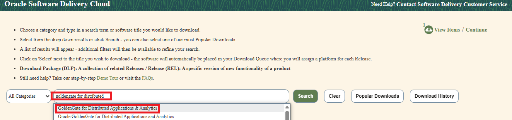

검색 결과에서 위쪽의 `DLP: Oracle GoldenGate for Distributed Applications
and Analytics 26.1.2`를 선택한다. `License Subscription` 항목은 선택하지 않는다.

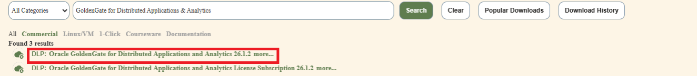

### 3.2 기존 항목 해제와 installer 선택

Download Queue에 이전 제품이 남아 있으면 모두 해제하고
`GoldenGate for Distributed Applications & Analytics 23.4.0.0.0`만
선택한다. Platform이 `Linux x86-64`이고 표시 크기가 `520.7 MB`인지
확인한다. `Oracle Transaction Manager for Microservices`는 선택하지 않는다.

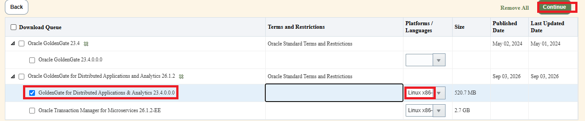

라이선스를 확인하고 동의한 뒤 `Continue`를 클릭한다.

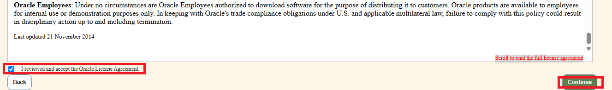

File list에서는 다음 installer 한 개만 선택한다.

```text
V1054834-01.zip
GoldenGate for Distributed Applications and Analytics 23.26.1.0.0 on Linux x86-64
Size: 520.7 MB
```

`Total 1 distinct files`인지 확인하고 `WGET Options`를 연 뒤
`Download wget.sh`를 클릭한다.

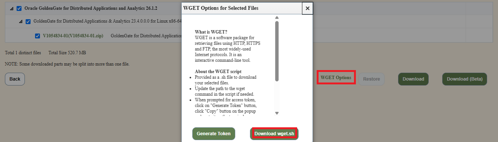

### 3.3 WGET script 실행

```text
[root@DESKTOP-4F78VMG pkg]# cd /mnt/c/Users/<WindowsUser>/Downloads/
[root@DESKTOP-4F78VMG Downloads]# ls -ltr wget.sh
-rwxrwxrwx 1 root root 2379 Oct 29 13:15 wget.sh
[root@DESKTOP-4F78VMG Downloads]# mv wget.sh /home/oracle/oracle/pkg/wget_oracle_goldengate_for_DAA_26ai.sh
[root@DESKTOP-4F78VMG Downloads]# cd /home/oracle/oracle/pkg/
[root@DESKTOP-4F78VMG pkg]# chmod 700 wget_oracle_goldengate_for_DAA_26ai.sh
[root@DESKTOP-4F78VMG pkg]# ls -ltr wget_oracle_goldengate_for_DAA_26ai.sh
-rwx------ 1 root root 2379 Oct 29 13:15 wget_oracle_goldengate_for_DAA_26ai.sh
[root@DESKTOP-4F78VMG pkg]#
```

Linux file name은 대소문자를 구분하므로 실행할 때도 `DAA`를 대문자로
정확히 입력한다.

```text
[root@DESKTOP-4F78VMG pkg]# sh wget_oracle_goldengate_for_DAA_26ai.sh
Please paste your access token and press Enter:
```

이전 제품에서 사용한 token을 재사용하지 않고 `Generate Token`을 클릭한다.

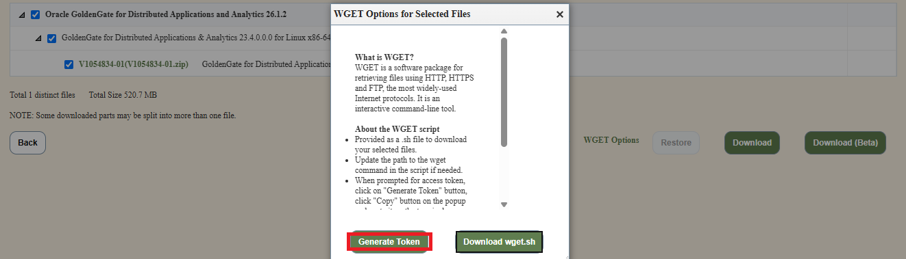

새 창에서 `Copy`를 클릭하고 터미널에 한 번만 붙여넣는다. 그림의 실제 token은
마스킹되어 있다.


### 3.4 파일 검증

```text
[root@DESKTOP-4F78VMG pkg]# sha256sum V1054834-01.zip
8971fdfeb734a30df09b486f3c49a99ff4335a0daced21a8f70783d783413c45  V1054834-01.zip
[root@DESKTOP-4F78VMG pkg]#
```

## 세 제품 다운로드 완료 확인

위의 실제 수행 결과에서 세 파일의 prompt, 명령, 대표 출력과 SHA-256을 모두
확인했다. DAA 파일의 `ls -lh` 결과는 실제 캡처가 추가되는 시점에 보강한다.
확인되지 않은 출력은 예시로 만들어 넣지 않는다. 세 checksum을 확인한 뒤
도서의 Docker image 일괄 build 단계로 넘어간다.

## 4. Oracle Stream Analytics/GGSA

Oracle Stream Analytics는 GoldenGate가 Kafka로 전달한 CDC event를 실시간으로
분석하고 pipeline과 dashboard로 시각화하는 실습에서 사용한다. 이 제품은
Oracle Stream Analytics 또는 OSA라고 부르며, 일부 GoldenGate 문서와
화면에서는 GoldenGate Stream Analytics 또는 GGSA라는 이름도 함께 사용한다.

이 절부터는 책 본문 분량에 포함하지 않고, 제품 화면과 실제 terminal 수행
결과를 이 공개 GitHub 가이드에 상세하게 기록한다.

### 4.1 Oracle Stream Analytics 26.1 검색

[Oracle Software Delivery Cloud](https://edelivery.oracle.com/)에 로그인한 뒤
검색창에 `Oracle Stream Analytics`를 입력하고 `Search`를 클릭한다.

검색 결과에는 다음 두 Product Pack이 함께 표시될 수 있다.

```text
DLP: Oracle Stream Analytics 26.1.0.0.0 (Oracle Stream Analytics)
DLP: Oracle Stream Analytics 19.1.0.0.0 (Oracle Stream Analytics)
```

현재 Lab Kit는 Java 21과 함께 사용하는 26.1 계열 media를 기준으로 하므로
위쪽의 `Oracle Stream Analytics 26.1.0.0.0`을 선택한다. 아래쪽의
`19.1.0.0.0`은 과거 실습 자산과 비교할 때만 참고하며, 현재 독자용 Lab Kit의
신규 설치 파일로 선택하지 않는다.

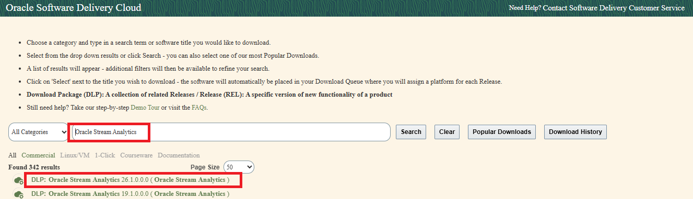

선택 후 화면 오른쪽 위 `View Items`의 선택 수가 증가하는지 확인하고
`Continue`를 클릭해 Download Queue로 이동한다. 같은 browser session에서
앞서 다운로드한 Database 또는 GoldenGate 항목이 남아 있다면 다음 화면에서
기존 항목을 해제해야 한다.

### 4.2 Download Queue에서 Linux x86-64 선택

Download Queue에서는 `Oracle Stream Analytics 26.1.0.0.0`의 상위 항목과
하위 release checkbox가 모두 선택되어 있는지 확인한다. 같은 browser
session에서 앞서 받은 Database, GoldenGate for Oracle, GoldenGate DAA가
남아 있다면 해당 제품의 상위 checkbox를 모두 해제한다. 이번 WGET script에는
Oracle Stream Analytics 파일만 포함되어야 한다.

`Platforms / Languages`는 `Linux x86-64`를 선택한다. 검증 화면에서
Oracle Stream Analytics 26.1 release의 표시 크기는 `1.6 GB`다. 다음 세
항목을 확인한 뒤 오른쪽 위의 `Continue`를 클릭한다.

- 선택 제품: `Oracle Stream Analytics 26.1.0.0.0`
- Platform: `Linux x86-64`
- Download Queue: Oracle Stream Analytics 한 제품만 선택

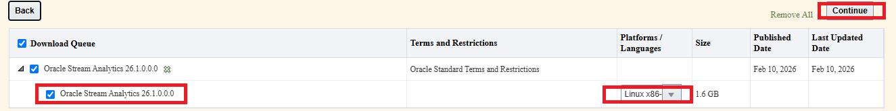

`1.6 GB`는 이 Download Queue에 표시되는 Product Pack release 크기다. 뒤의
file list에서 실제로 받을 installer의 파일명, 제품 설명, 개별 파일 크기를
다시 확인한다.

### 4.3 Oracle License Agreement 확인

`Continue`를 클릭하면 Oracle Stream Analytics에 적용되는 license agreement가
표시된다. 화면 오른쪽의 scroll을 내려 현재 계정과 제품에 적용되는 전체
내용을 직접 확인한다. 내용을 검토한 뒤 왼쪽 아래의
`I reviewed and accept the Oracle License Agreement` checkbox를 선택하고,
오른쪽 아래의 `Continue`를 클릭한다.

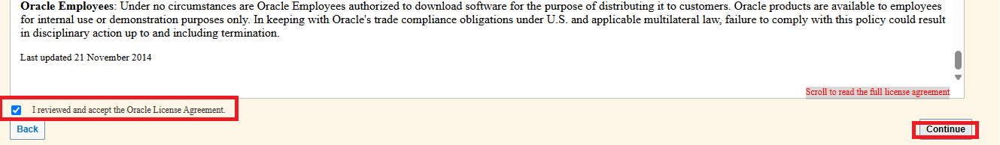

화면에 표시되는 agreement의 제목과 세부 문구는 계정 유형, 제품 release,
다운로드 시점에 따라 달라질 수 있다. 검증 화면에는 Oracle 직원 계정의
내부 사용 및 고객 재배포 제한이 별도로 표시됐다. 이 문구는 모든 독자에게
동일하게 표시된다고 가정하지 않으며, 각 독자는 자신의 화면에 나타나는
조건을 직접 확인해야 한다.

이 GitHub 저장소와 Lab Kit Release는 Oracle Stream Analytics installer를
재배포하지 않는다. 독자는 본인의 Oracle 계정과 사용 권한으로 license에
동의하고 제품 media를 직접 내려받는다.

### 4.4 Installer 확인과 WGET script 다운로드

License agreement를 통과하면 실제 다운로드 파일 목록이 표시된다. 다음 한
파일만 선택되어 있는지 확인한다.

```text
V1054826-01.zip
Oracle Stream Analytics 26.1.0.0.0 for Linux x86-64
Size: 1.6 GB
```

화면 아래쪽의 `Total 1 distinct files`와 `Total Size 1.6 GB`도 함께 확인한다.
파일이 두 개 이상 보이거나 전체 크기가 다르면 이전 Download Queue로 돌아가
불필요한 제품이 선택되어 있지 않은지 점검한다.

선택한 파일이 맞으면 화면 위쪽 또는 아래쪽의 `WGET Options`를 클릭한다.
`WGET Options for Selected Files` 팝업이 열리면 `Download wget.sh`를 클릭해
Oracle Stream Analytics installer용 WGET script를 Windows Downloads 폴더에
저장한다.

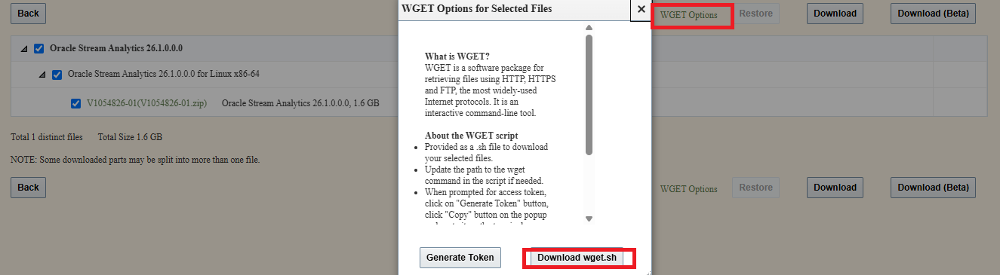

같은 팝업의 `Generate Token`은 WGET script 실행 직전에 사용한다. Access
token의 유효 시간이 짧을 수 있으므로 script를 먼저 WSL의 지정 위치로 옮기고
실행 준비를 마친 뒤 새 token을 생성한다.

### 4.5 WGET script를 `centos/pkg`에 배치하고 실행

Windows Downloads 폴더에 저장된 `wget.sh`를 WSL로 옮기면서 제품 용도가
드러나는 `wget_oracle_stream_analytics_26ai.sh`로 이름을 바꾼다.

앞의 Database와 GoldenGate installer는 `/home/oracle/oracle/pkg`에
배치했지만, Oracle Stream Analytics는 Kafka와 Spark가 실행되는
`demo_centos` image에서 사용한다. 따라서 OSA용 WGET script와 다운로드
결과는 `/home/oracle/centos/pkg`에 둬야 한다. 현재 Lab Kit의
`preflight_downloads.sh`도 이 위치의 `V1054826-01.zip`을 검사한다.

처음부터 올바른 위치로 옮기는 최종 독자용 절차는 다음과 같다.

```text
[root@DESKTOP-4F78VMG pkg]# cd /mnt/c/Users/<WindowsUser>/Downloads/
[root@DESKTOP-4F78VMG Downloads]# ls -ltr wget.sh
-rwxrwxrwx 1 root root 2379 Oct 29 14:36 wget.sh
[root@DESKTOP-4F78VMG Downloads]# mv wget.sh /home/oracle/centos/pkg/wget_oracle_stream_analytics_26ai.sh
[root@DESKTOP-4F78VMG Downloads]# cd /home/oracle/centos/pkg
[root@DESKTOP-4F78VMG pkg]# chmod 700 wget_oracle_stream_analytics_26ai.sh
[root@DESKTOP-4F78VMG pkg]# ls -ltr wget_oracle_stream_analytics_26ai.sh
-rwx------ 1 root root 2379 Oct 29 14:36 wget_oracle_stream_analytics_26ai.sh
[root@DESKTOP-4F78VMG pkg]#
```

이미 `/home/oracle/oracle/pkg`로 옮겼다면 다시 다운로드하지 말고 다음처럼
`centos/pkg`로 이동한다. `mv`는 기존의 `700` 권한을 그대로 유지한다.

```text
[root@DESKTOP-4F78VMG pkg]# mv wget_oracle_stream_analytics_26ai.sh /home/oracle/centos/pkg/
[root@DESKTOP-4F78VMG pkg]# cd /home/oracle/centos/pkg
[root@DESKTOP-4F78VMG pkg]# ls -ltr wget_oracle_stream_analytics_26ai.sh
-rwx------ 1 root root 2379 Oct 29 14:36 wget_oracle_stream_analytics_26ai.sh
```

`centos/pkg`에서 script를 실행하면 access token 입력을 기다린다.

```text
[root@DESKTOP-4F78VMG pkg]# sh wget_oracle_stream_analytics_26ai.sh
Please paste your access token and press Enter:
```

이 prompt가 표시된 terminal은 닫지 않고 그대로 둔다.

### 4.6 Access token 생성

브라우저의 `WGET Options for Selected Files` 팝업으로 돌아가
`Generate Token`을 클릭한다. 앞에서 Database 또는 GoldenGate를 받을 때
사용한 token은 재사용하지 않고, OSA 다운로드를 시작하기 직전에 새 token을
생성한다.

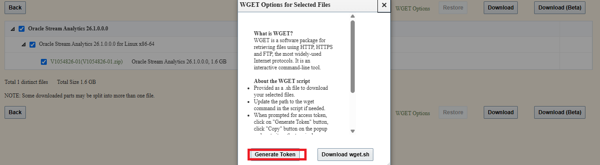

다음 화면에서 access token이 표시되면 `Copy`를 한 번 클릭한다. Token은
터미널에 한 번만 붙여넣고 Enter를 누르며, 화면 캡처나 GitHub 문서에는 실제
값과 callback 인증 코드를 남기지 않는다.

### 4.7 Access token 복사와 terminal 입력

새 browser 화면에 `Your Access Token`이 표시되면 `Copy`를 한 번 클릭한다.
아래 화면의 token은 공개 문서용으로 마스킹했으며, 실제 token 값은 저장하거나
공유하지 않는다.


앞에서 실행해 둔 terminal로 돌아가 `Please paste your access token and press
Enter:` prompt 뒤에 token을 **한 번만** 붙여넣고 Enter를 누른다. Terminal
설정에 따라 붙여넣은 긴 token이 화면에 보이지 않거나, 입력 직후 잠시 출력이
없는 것처럼 보일 수 있다. 정상적으로 한 번 붙여넣고 Enter를 눌렀다면 script가
다운로드를 시작하므로 잠시 기다린다.

붙여넣기가 되었는지 확신이 없어도 같은 token을 다시 붙여넣지 않는다. 두 번
입력했거나 잘못 입력한 경우에는 `Ctrl+C`로 현재 script를 중지하고 다시 실행한
뒤, 필요하면 새 token을 생성해 한 번만 입력한다.

Access token은 짧은 시간 동안만 유효한 임시 인증 정보다. 만료되었거나 다른
server에서 나중에 다시 다운로드한다면 `Generate Token`을 다시 클릭해 새
token을 사용한다. Token 문자열과 browser 주소의 callback code는 terminal
capture, 문서, GitHub issue 또는 commit에 남기지 않는다.

### 4.8 Oracle Stream Analytics installer 다운로드 완료

Token을 붙여넣고 Enter를 누르면 WGET script가 background download를
시작한다. 다음 검증에서는 `1.6 GB` installer를 내려받는 동안 약 16분간
추가 진행률이 표시되지 않았다. `Download initiated (background)`와
`All download(s) initiated in background`가 표시됐다면 prompt가 바로
돌아오지 않아도 terminal을 닫거나 `Ctrl+C`를 누르지 말고 완료 메시지를
기다린다.

다음은 실제 수행 결과에서 access token만 마스킹한 transcript다.

```text
[root@DESKTOP-4F78VMG pkg]# sh wget_oracle_stream_analytics_26ai.sh
Please paste your access token and press Enter:
[ACCESS TOKEN MASKED]
[INFO] [2026-10-29 14:40:24] ==== Script Started ====
[INFO] [2026-10-29 14:40:24] Download initiated (background) for: V1054826-01.zip
[INFO] [2026-10-29 14:40:24] All download(s) initiated in background.
Please check logfile for more details: ./wgetlog-10-29-26-14:39.log
[INFO] [2026-10-29 14:56:40] Download completed: V1054826-01.zip (saved to: ./V1054826-01.zip)
[INFO] [2026-10-29 14:56:40] ==== Script Finished ====
[root@DESKTOP-4F78VMG pkg]#
```

`saved to: ./V1054826-01.zip`의 `./`는 WGET script를 실행한 현재 directory를
뜻한다. 다음 명령으로 `/home/oracle/centos/pkg`에서 실행했는지 확인하고,
파일 크기와 SHA-256을 계산한다.

```text
[root@DESKTOP-4F78VMG pkg]# pwd
[root@DESKTOP-4F78VMG pkg]# ls -lh V1054826-01.zip
[root@DESKTOP-4F78VMG pkg]# sha256sum V1054826-01.zip
```

`pwd`가 `/home/oracle/oracle/pkg`라면 다운로드를 다시 하지 말고 완성된 ZIP을
다음처럼 옮긴 뒤 `centos/pkg`에서 검증한다.

```text
[root@DESKTOP-4F78VMG pkg]# mv V1054826-01.zip /home/oracle/centos/pkg/
[root@DESKTOP-4F78VMG pkg]# cd /home/oracle/centos/pkg
[root@DESKTOP-4F78VMG pkg]# ls -lh V1054826-01.zip
[root@DESKTOP-4F78VMG pkg]# sha256sum V1054826-01.zip
```

현재 단계에서는 독자가 실제로 확인한 파일 크기와 SHA-256 결과를 기록한다.
최종 Lab Kit checksum manifest에는 전체 제품 media를 한 서버에 모아 다시
검증한 뒤 확정한 값만 반영한다.

### 4.9 다운로드 파일 확인과 배치 경로 수정

실제 다운로드 직후 확인한 결과는 다음과 같다. 파일은 정상적으로 생성됐지만
`pwd`가 `/home/oracle/oracle/pkg`이므로 OSA용 배치 경로와 일치하지 않는다.

```text
[root@DESKTOP-4F78VMG pkg]# pwd
/home/oracle/oracle/pkg
[root@DESKTOP-4F78VMG pkg]# ls -lh V1054826-01.zip
-rw-r--r-- 1 root root 1.7G Feb 10  2026 V1054826-01.zip
[root@DESKTOP-4F78VMG pkg]# sha256sum V1054826-01.zip
3da480b24b2dcd903e8f9ab2ed2e21937de8c5dee97260cc0ec86ed0ae0df341  V1054826-01.zip
```

`ls -lh`의 `1.7G`와 eDelivery 화면의 `1.6 GB`는 표시 단위와 반올림 방식에
따라 다르게 보일 수 있다. 파일명과 크기를 함께 확인하고, 정확한 파일 식별과
무결성 확인에는 SHA-256 값을 사용한다.

OSA installer는 `demo_centos` image 구성에 사용되므로 파일을 다시 다운로드하지
말고 `/home/oracle/centos/pkg`로 옮긴다. 이동 후 같은 checksum이 출력되는지
다시 확인한다.

```text
[root@DESKTOP-4F78VMG pkg]# mv V1054826-01.zip /home/oracle/centos/pkg/
[root@DESKTOP-4F78VMG pkg]# cd /home/oracle/centos/pkg
[root@DESKTOP-4F78VMG pkg]# pwd
/home/oracle/centos/pkg
[root@DESKTOP-4F78VMG pkg]# ls -lh V1054826-01.zip
[root@DESKTOP-4F78VMG pkg]# sha256sum V1054826-01.zip
```

이동 전 확인한 SHA-256은 다음과 같다. 이동은 파일 내용을 변경하지 않으므로
이동 후에도 같은 값이 나와야 한다.

```text
3da480b24b2dcd903e8f9ab2ed2e21937de8c5dee97260cc0ec86ed0ae0df341  V1054826-01.zip
```

이 값은 현재 다운로드 검증 기록이다. 최종 자동 preflight에서 사용할 checksum
manifest 값은 필요한 제품 media를 모두 준비한 뒤 검증 환경에서 다시 확인해
확정한다.

### 4.10 `centos/pkg` 최종 배치 확인

ZIP과 WGET script를 `/home/oracle/centos/pkg`로 옮긴 뒤 실제로 확인한 결과는
다음과 같다.

```text
[root@DESKTOP-4F78VMG pkg]# ls -ltr
total 1708308
-rw-r--r-- 1 root root 1749299087 Feb 10  2026 V1054826-01.zip
-rwx------ 1 root root       2379 Oct 29 14:36 wget_oracle_stream_analytics_26ai.sh
[root@DESKTOP-4F78VMG pkg]# pwd
/home/oracle/centos/pkg
[root@DESKTOP-4F78VMG pkg]# sha256sum V1054826-01.zip
3da480b24b2dcd903e8f9ab2ed2e21937de8c5dee97260cc0ec86ed0ae0df341  V1054826-01.zip
[root@DESKTOP-4F78VMG pkg]#
```

이동 전후 SHA-256이 같으므로 파일 내용은 변경되지 않았다. OSA installer와
해당 installer를 받은 WGET script가 모두 Lab Kit의 지정 위치에 준비됐다.

## 5. Oracle JDK 21 Linux x64 RPM 다운로드

Oracle Stream Analytics 26ai runtime에는 JDK 21이 필요하다. Lab Kit은
`demo_centos` container에서 RPM을 설치하며, 다음 파일명과 위치를 기준으로
검사한다.

이 절의 화면과 version 정보는 `2026-10-29`에 확인했다. Oracle 사이트의 화면,
세부 version, license와 로그인 방식은 이후 변경될 수 있다.

```text
/home/oracle/centos/pkg/jdk-21_linux-x64_bin.rpm
```

### 5.1 Oracle Java Downloads 접속과 package 선택

Browser에서 [Oracle Java Downloads](https://www.oracle.com/java/technologies/downloads/)
에 접속하고 `Java 21` tab을 선택한다. 다운로드 전에 화면에 표시된 현재
license 조건을 직접 확인한다. 검증 시점의 화면에는 JDK 21.0.13 이상에 적용되는
Oracle Technology Network License Agreement가 이전 JDK 21 license와 다르다는
안내가 표시됐다.

`Linux` tab에서 다음 항목을 선택한다.

- Product/file description: `x64 RPM Package`
- 검증 시점 파일명: `jdk-21.0.13.0.3_linux-x64_bin.rpm`
- 검증 시점 표시 크기: `189.6 MB`

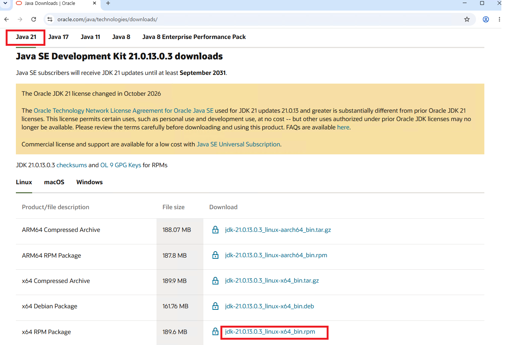

`ARM64` package는 ARM 기반 Linux용이고, `.deb`는 Debian 계열 package다.
이 Lab Kit의 x86-64 CentOS container에는 맨 아래의 `x64 RPM Package`를
사용한다. JDK update에 따라 version과 파일 크기는 달라질 수 있으므로 제품
종류와 architecture를 기준으로 선택한다.

### 5.2 Oracle Java SE license 확인과 동의

`jdk-21.0.13.0.3_linux-x64_bin.rpm` 링크를 클릭하면 Oracle Technology Network
License Agreement 확인 창이 열린다. 안내된 license 원문을 직접 검토하고,
사용 목적에 적용되는 조건을 확인한 뒤 동의하는 경우에만
`I reviewed and accept the Oracle Technology Network License Agreement for
Oracle Java SE` checkbox를 선택한다.

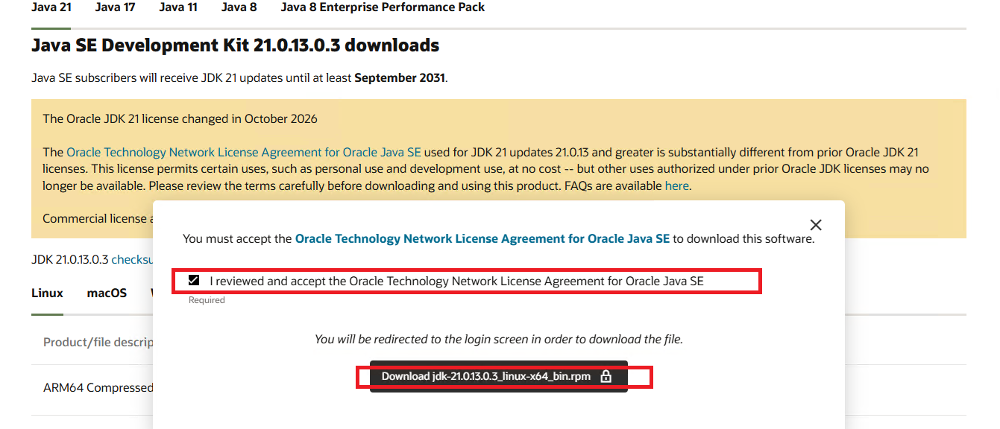

Checkbox를 선택하면 아래의
`Download jdk-21.0.13.0.3_linux-x64_bin.rpm` 버튼이 활성화된다. 버튼을
클릭하면 Oracle login 화면으로 이동한다. Oracle 계정으로 로그인한 뒤 RPM을
Windows Downloads 폴더에 저장한다.

License 문구, 로그인 요구 사항, package version은 Oracle 정책과 update에
따라 변경될 수 있다. 이 저장소는 JDK RPM을 재배포하지 않으며, 각 독자가
자신의 사용 조건을 확인하고 Oracle 공식 사이트에서 직접 다운로드한다.

### 5.3 화면 변경 시 선택 기준과 대체 경로

기본 다운로드 경로는 Oracle Java Downloads다. 화면이 개편됐거나 해당
package를 찾기 어렵다면 [Oracle Software Delivery Cloud](https://edelivery.oracle.com/)
에서 `Oracle JDK`를 검색하고 JDK 21 release를 선택하는 방법을 대체 경로로
사용한다.

어느 공식 사이트를 사용하더라도 다음 네 조건을 모두 만족하는 package를
선택한다.

- Major version: `JDK 21`
- Operating system: `Linux`
- Architecture: `x86-64` 또는 `x64`
- Package format: `RPM`

책이나 온라인 부록의 화면과 현재 Oracle 사이트가 다르면 버튼 위치나 표시
순서보다 위 조건을 우선한다. 최신 update가 게시되면 세부 version과 다운로드
파일명은 달라질 수 있다. 다운로드한 version 포함 파일명은 뒤 단계에서 Lab Kit
기준 이름인 `jdk-21_linux-x64_bin.rpm`으로 변경하고 SHA-256을 기록한다.

## 다음 업데이트 대상

Oracle JDK 21 RPM을 Windows Downloads 폴더에서 `/home/oracle/centos/pkg`로
옮겨 Lab Kit 기준 파일명으로 변경하고, 파일 크기와 SHA-256을 확인하는 절차를
실제 수행 결과에 따라 계속 추가한다.
ZooKeeper, Kafka, Spark는 현재 Lab Kit의 Dockerfile이 Apache Archive에서
자동으로 내려받고 고정된 SHA-512 checksum으로 검증하므로 독자가 별도로
다운로드하지 않는다.
